# ZENITH — a green-phosphor slideshow for a vintage composite monitor

A Raspberry Pi drives a 1980s **Zenith ZVM-123** monochrome monitor over composite video and plays an endless,
self-generating slideshow: a live **ADS-B air-traffic radar scope**, today's weather painted as a scene, the
aurora forecast, and a set of classic demoscene and generative pieces. Everything is drawn in pure Python + numpy on
a 320×240 canvas and written straight to the Pi's composite output through KMS. No X, no SDL, no AI, no
accounts and no API keys: live data comes only from free public feeds, and each feed falls back to a cached or
offline picture.

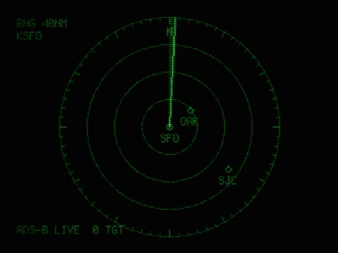

*Live radar around San Francisco (adsb.lol), rendered headless with the simulated tube.*

---

## The radar scope (the star of the show)

`radar` is a PPI (plan-position indicator) scope in the style of an old ATC/ASR display:

- **Rotating sweep** with long-persistence phosphor decay: echoes light up as the beam passes and fade over the
  next revolution, like a real P7/P31 tube.
- **Real traffic** from [adsb.lol](https://api.adsb.lol), a free community ADS-B aggregator using the ADS-B
  Exchange v2 JSON schema: `GET /v2/point/{lat}/{lon}/{radius_nm}`. Polled every few seconds in a background
  thread, **only while the radar scene is on screen**, with backoff on HTTP 429.
- **Dead reckoning** between polls: each target is moved along its track at its ground speed, so blips advance
  smoothly between sweeps instead of jumping.
- **Data blocks** next to each target: callsign (or registration), altitude in hundreds of feet, and the route
  when it's known (`SLC-SFO`).
- **Validated routes.** Callsign→route databases are often stale or wrong (multi-stop routes, reused flight numbers).
  Routes come from adsb.lol's route API, with [adsbdb](https://www.adsbdb.com) (`/v0/callsign/{call}`) as a fallback, and
  a route is shown only if it fits what the aircraft is actually doing: `route_leg()` in `feeds.py` picks the leg
  whose great circle the aircraft is within max(50 NM, 10 % of the leg) of, between its endpoints, and (unless
  within 20 NM of the destination) heading within 60° of the bearing to it. Otherwise no route is shown rather than a wrong one.
- **Range rings, compass ticks, ground clutter** and airport diamonds you choose (`[radar] marks`).
- Offline or without network: **synthetic N-number traffic**, so the scene always looks alive.

| Synthetic traffic (offline) | Live, busy airspace |
|---|---|
| 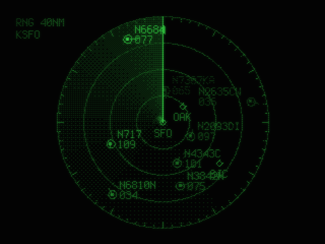 | 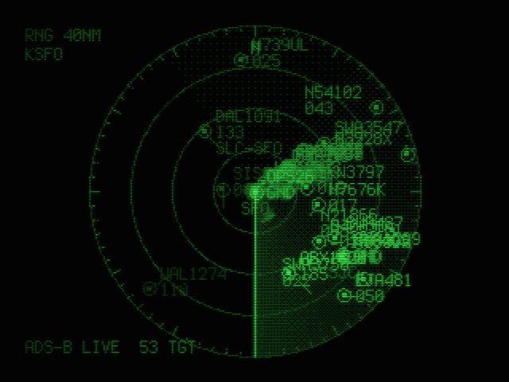 |

Configure it in `config.toml`:

```toml
[radar]
lat = 37.6213              # scope centre
lon = -122.3790
range_nm = 40
label = "KSFO"             # tag in the scope corner
marks = [["SFO", 37.6213, -122.3790], ["OAK", 37.7213, -122.2208], ["SJC", 37.3626, -121.9291]]
live = true                # false = synthetic traffic only
```

## All the scenes

| | | |
|---|---|---|
| 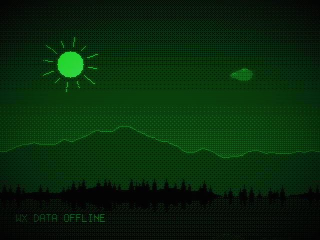 **weather**: today's conditions as a landscape: sun or phase-correct moon, clouds moved by the real wind, rain/snow, 2-day outlook, moon age and illumination (Meeus), daylight trend, meteor showers | 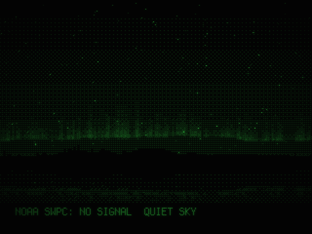 **aurora-sky**: aurora curtains over mountains and a lake, driven by NOAA OVATION + Kp | 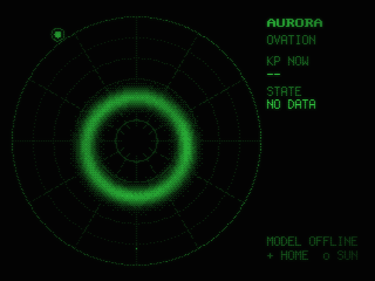 **aurora-oval**: the 30-minute OVATION forecast as a polar map with graticule and the sun's side |
| 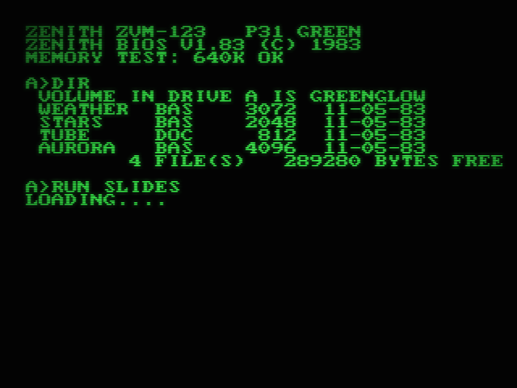 **terminal**: a green-screen DOS session: memory test, DIR, RUN | 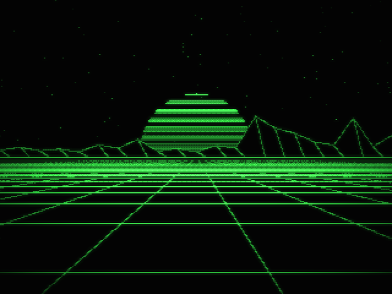 **vector-flight**: perspective-grid flight toward a slit sun | 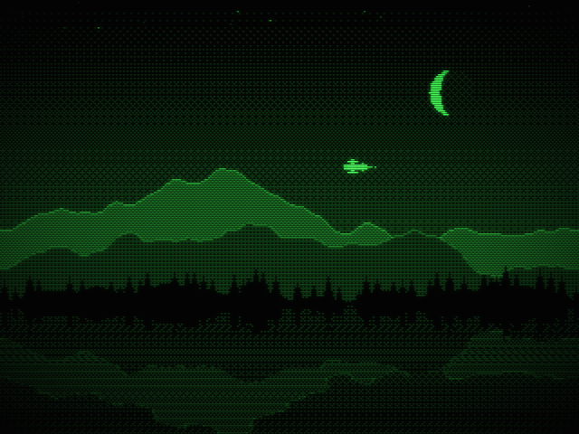 **lake-night**: mountains over a still lake, phase-correct moon, a biplane droning across |
| 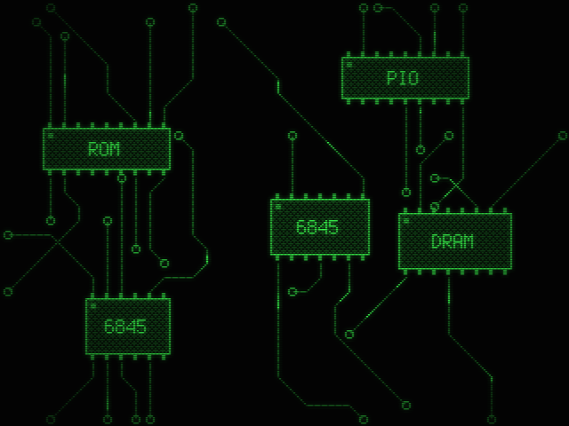 **circuit**: a PCB drawing itself, then signals running the traces | 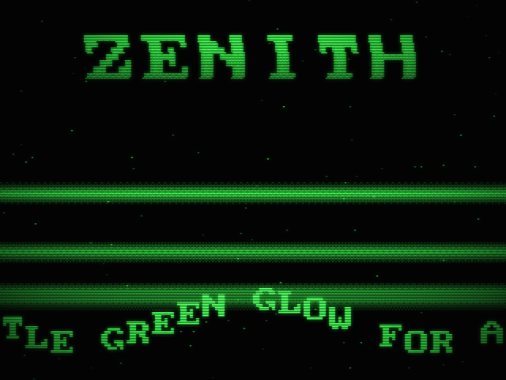 **copper-scroll**: demoscene copper bars, wobbling logo, sine scroller | 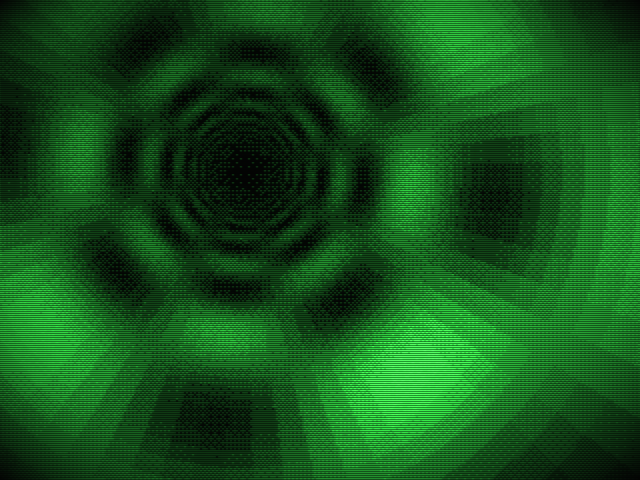 **tunnel**: the classic table-driven texture tunnel |
| 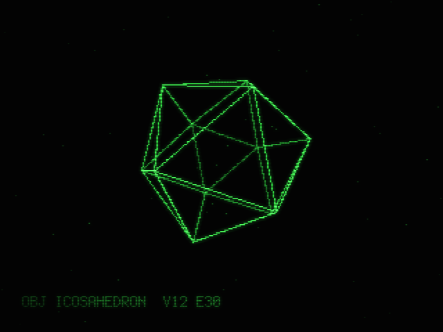 **wireframe**: tesseract, torus or icosahedron with depth cueing | 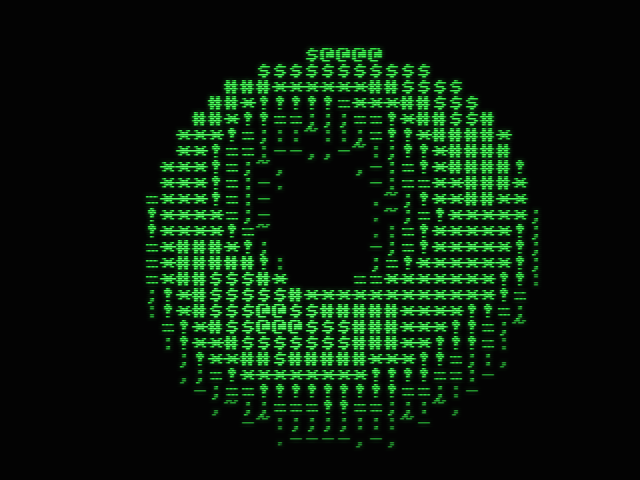 **ascii-torus**: spinning torus in 40×30 text mode | 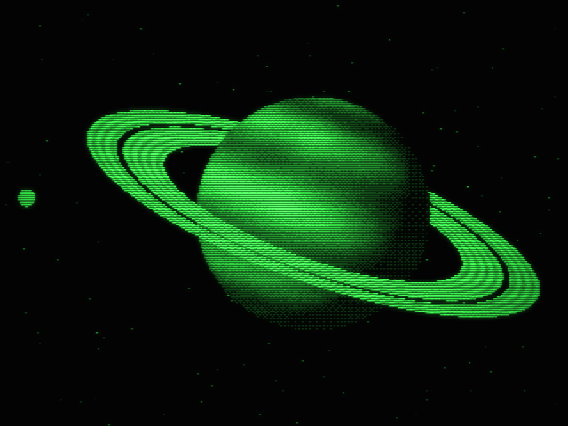 **planet**: banded gas giant with rings and a moon |
| 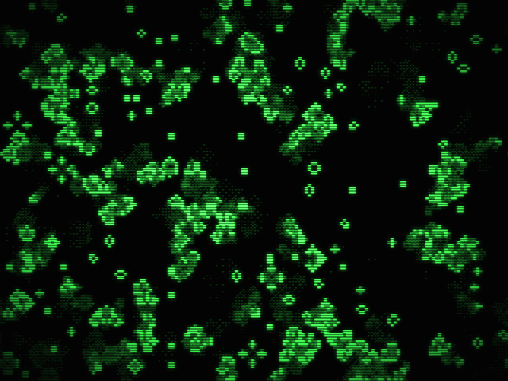 **life**: Conway's Life with phosphor trails | 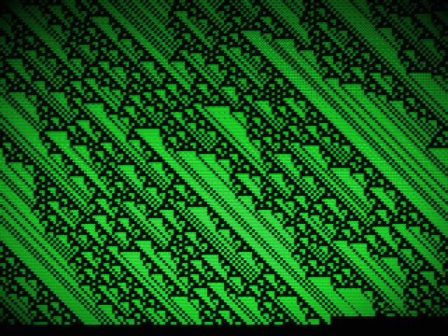 **rule-ca**: 1-D Wolfram automaton printing like a teletype | 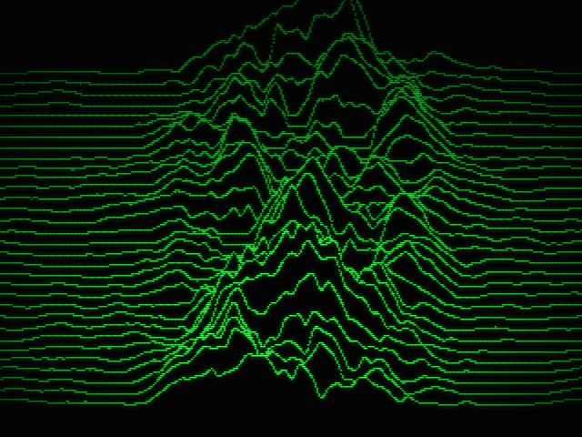 **ridgelines**: floating-horizon noise terrain |
| 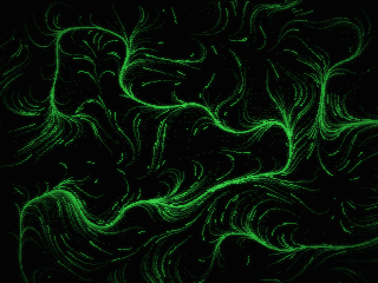 **flow-field**: particles combing a turning noise field | 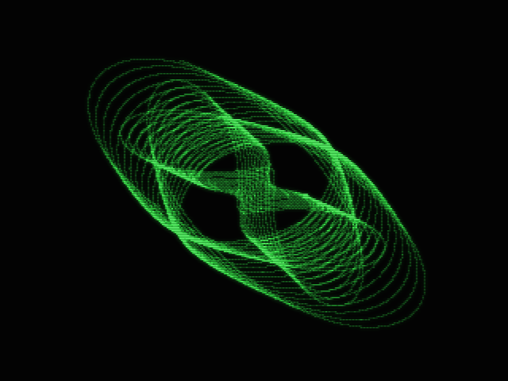 **harmonograph**: a damped two-pendulum pen plot | 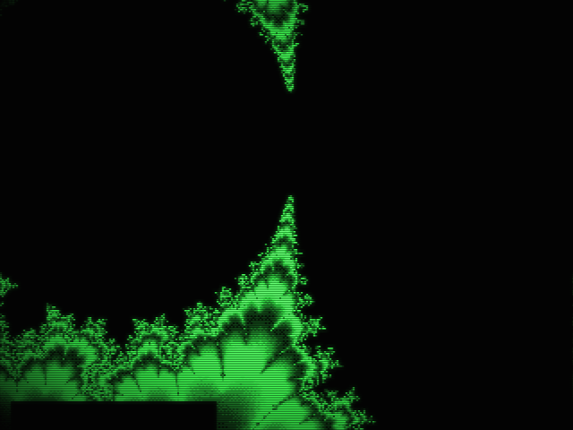 **mandelbrot**: drawn line by line like a 1985 micro, then palette-cycled |
| 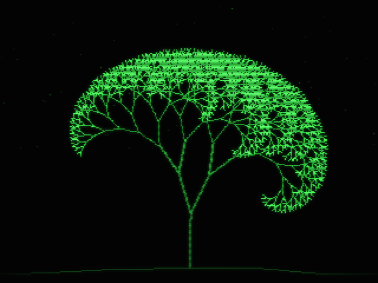 **fractal-tree**: a recursive tree swaying in the wind | 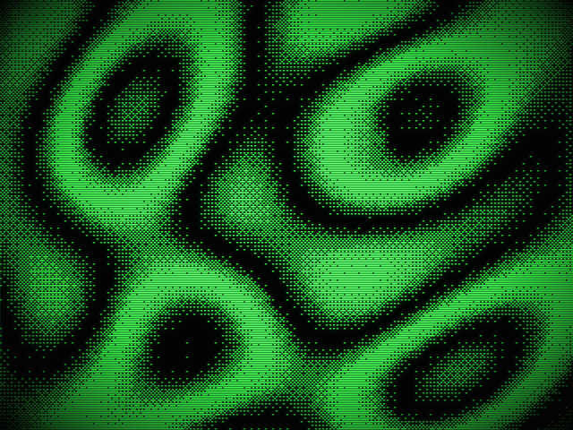 **plasma**: old-school sine plasma, ordered-dithered | |

Scenes change every 8–20 s with one of seven transitions. Quiet scenes can show a faint, still line from the
*Tao Te Ching* (James Legge's 1891 public-domain translation, `textdata.py`).

## Public data feeds (no keys)

| Feed | Used for | Endpoint |
|---|---|---|
| [Open-Meteo](https://open-meteo.com) | weather scene | `api.open-meteo.com/v1/forecast` |
| [NOAA SWPC](https://www.swpc.noaa.gov) | aurora scenes | `services.swpc.noaa.gov/json/ovation_aurora_latest.json`, `planetary_k_index_1m.json`, `products/noaa-planetary-k-index-forecast.json` |
| [adsb.lol](https://api.adsb.lol) | radar traffic | `api.adsb.lol/v2/point/{lat}/{lon}/{nm}`, routes `api/0/route/{call}/{lat}/{lon}` |
| [adsbdb](https://www.adsbdb.com) | route fallback | `api.adsbdb.com/v0/callsign/{call}` |
| [ipapi.co](https://ipapi.co) | location if none configured | `ipapi.co/json/` |

Every feed is cached and fails soft: a dead network shows the last good data or an offline picture, never a crash.

## Build it

**Hardware**
- Raspberry Pi 3B+ (any Pi with composite out should work; check `--bench` on yours).
- A monochrome composite monitor (Zenith ZVM-123 here; any green/amber/white mono monitor or a TV works).
- A **Raspberry Pi AV cable** (3.5 mm TRRS → RCA). Composite video is on the jack's **sleeve**, and camcorder
  TRRS cables usually wire it differently, so use a genuine Pi AV cable or check the pinout.

**Why grey, not green:** a mono composite monitor shows luma only. Sending pure green gives only 59 % brightness
and puts a colour subcarrier on the signal, which a mono tube shows as dot crawl. The program sends equal R=G=B grey
and the P31 phosphor does the green. Use `output = "green"` only on a colour screen.

**Software** (Raspberry Pi OS / Debian 12+):

```sh
sudo apt install python3-numpy           # all the default KMS backend needs
git clone https://github.com/mister-bernard/zenith-crt && cd zenith-crt
cp config.example.toml config.toml        # set your location and radar centre
sudo bash setup-crt.sh                    # composite on, service installed, reboot
```

`setup-crt.sh` does, with backups and `--rollback`:
1. `/boot/firmware/config.txt`: `dtoverlay=vc4-kms-v3d,composite`; `cmdline.txt`: `video=Composite-1:720x480@60ie,tv_mode=NTSC`
2. a system user `zenith` (groups `video`, `render`), code in `/opt/zenith` (root-owned), cache in `/var/cache/zenith`
3. `zenith-crt.service` (starts at boot) and `zenith-ctl` to steer it: `sudo zenith-ctl list | radar | pin <scene> | unpin | next | now`

Calibrate overscan on a real tube with the test cards: `sudo /opt/zenith/tcrun.sh 60 auto edges` (also `card`,
`ramp`), then set `margin_x`/`margin_y` in `config.toml`.

**Develop without a Pi or a monitor:**

```sh
python3 zenith.py --list
python3 zenith.py --offline --snap out/                 # one PNG per scene, simulated tube
python3 zenith.py --only radar --preview radar.mp4 --seconds 30   # needs ffmpeg
python3 zenith.py --bench                               # per-scene render time on this CPU
python3 -m unittest test_zenith                         # no display, no network
```

## How it draws

- 320×240 canvas = 40×30 cells of the IBM 8×8 font; on 480i each canvas line is drawn twice so 1-px details never flicker.
- Few grey levels (default 6) plus **ordered dithering**, which reads as authentic on a tube with a dead contrast pot.
- Output backends: direct **KMS/DRM dumb buffers** (`kms.py`, no dependencies), pygame, or `/dev/fb0`.
- `--snap`/`--preview` add a simulated tube (scanlines and glow) for screenshots; leave `crt_sim` off on a real CRT.

## Files

`zenith.py` main loop, transitions, CLI · `scene.py` scene base · `scenes_classic.py` radar and demoscene scenes ·
`scenes_gen.py` generative · `scenes_live.py` weather and aurora · `feeds.py` data feeds, ADS-B poller, route
validation · `almanac.py` moon and sun maths · `gfx.py` drawing, text, dithering · `land.py` landscapes ·
`kms.py` KMS output · `fontdata.py` bitmap fonts (generated by `tools/gen_font.py`) · `textdata.py` Tao lines
(generated by `tools/build_texts.py`) · `setup-crt.sh`, `tcrun.sh` install and calibration.

## Credits and licence

Code: MIT (see `LICENSE`). Bitmap fonts are converted from the Linux console fonts in the `kbd` package (VGA 8×8 and
Terminus, which is under the SIL Open Font License). The Tao text is James Legge's 1891 translation via Project
Gutenberg #216 (public domain). Data courtesy of Open-Meteo (CC BY 4.0), NOAA SWPC, adsb.lol (ODbL) and adsbdb.
